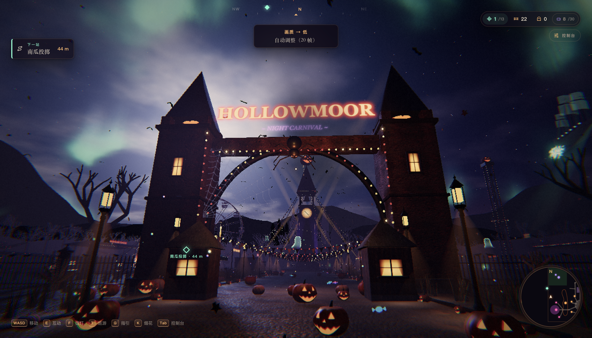
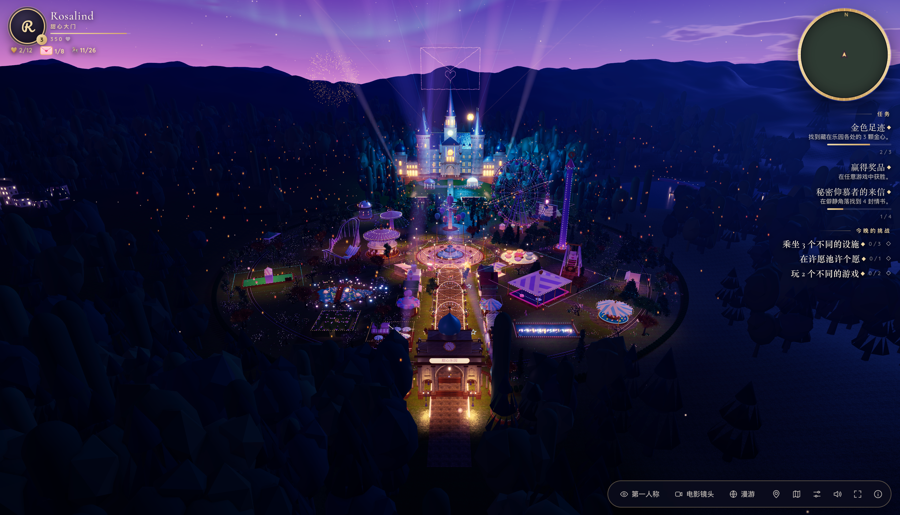
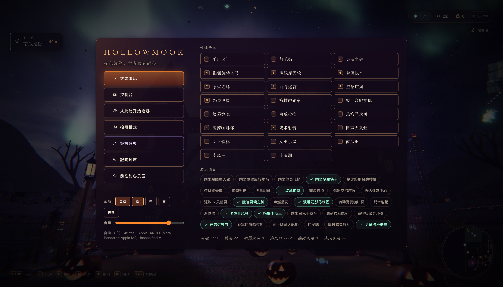
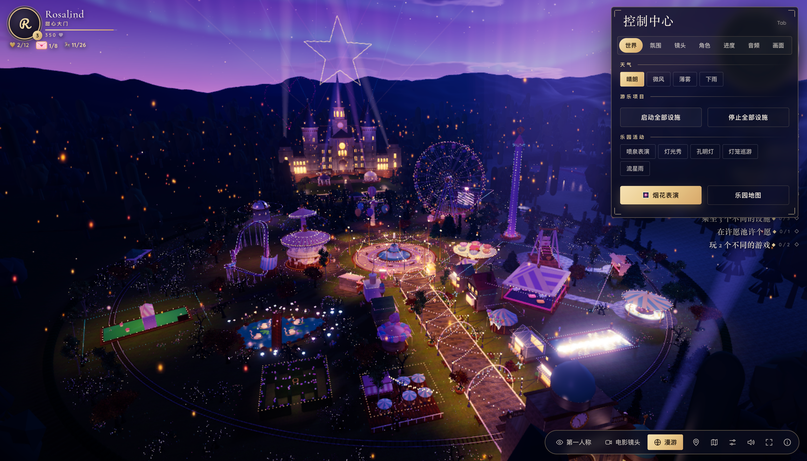
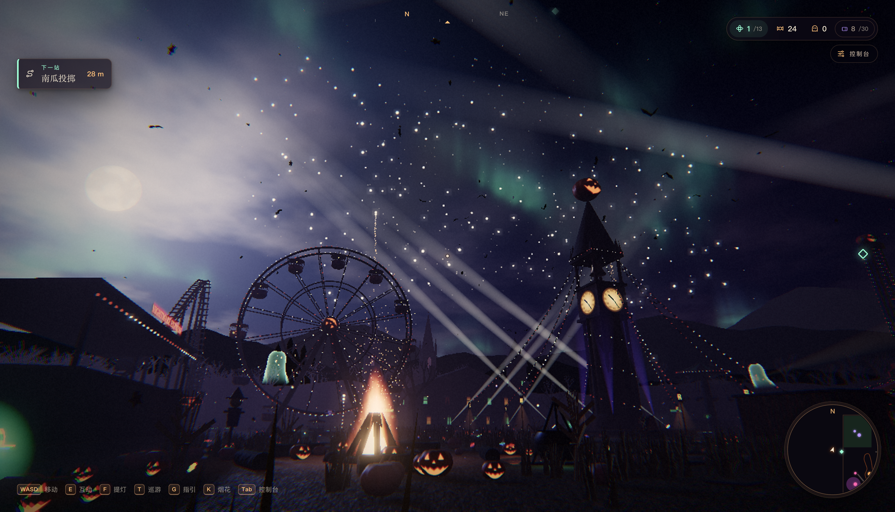
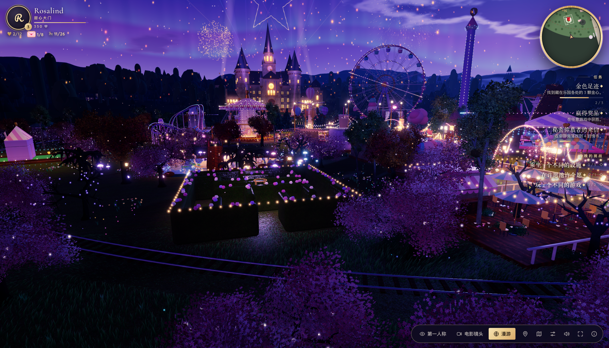
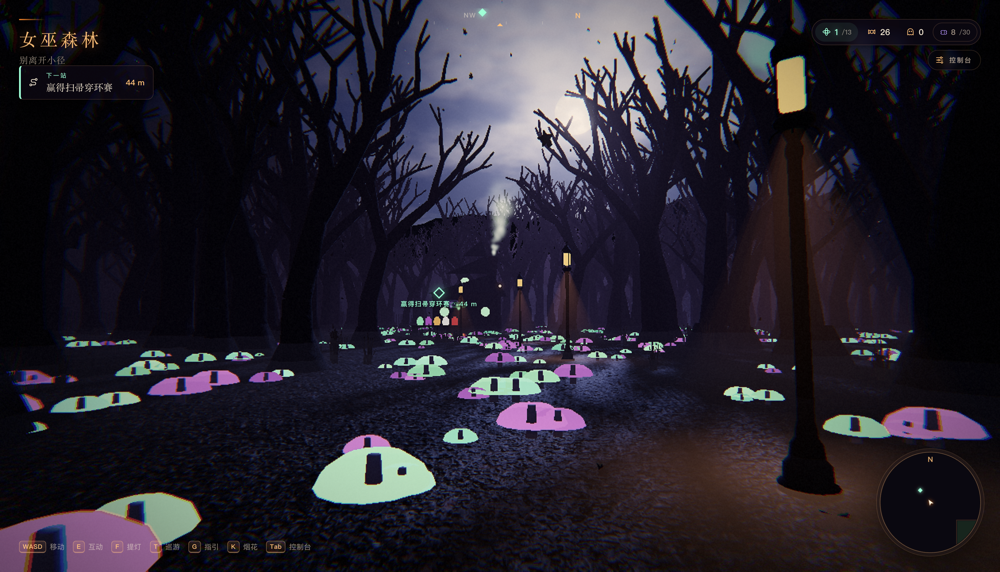
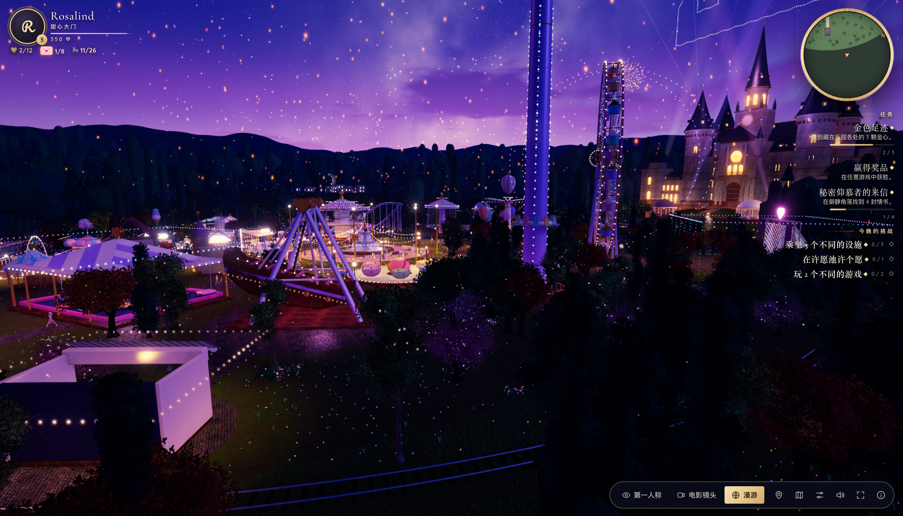
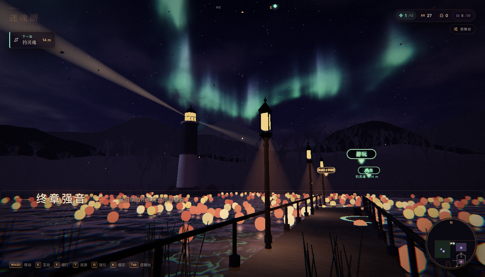
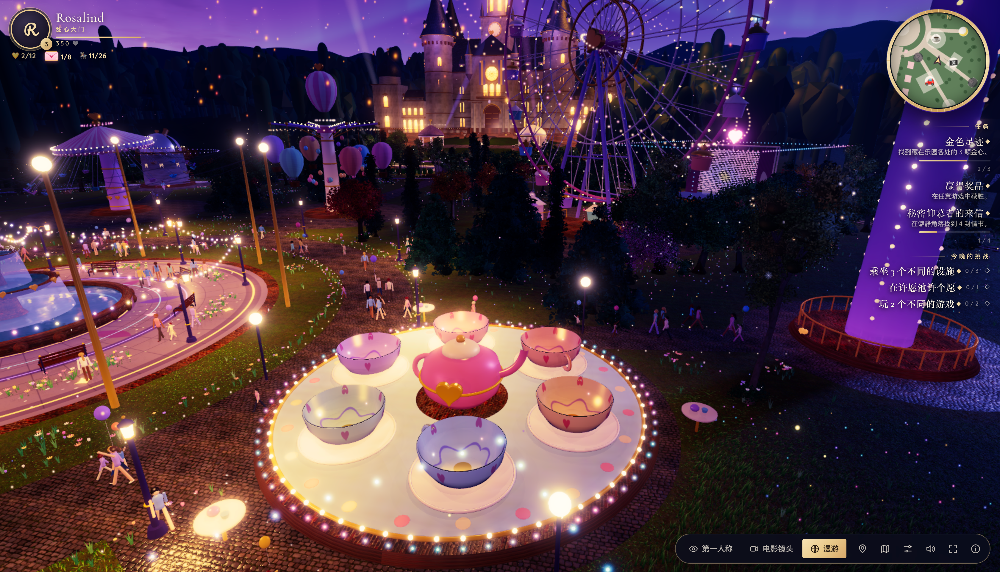

## 🤝 友情链接 / Friend Links

| 站点 Site | 链接 Link |
| :--- | :--- |
| 🤖 **Ai 资源网** | <https://human.rlybtd.com/> |

---

<div align="center">

<h1>🎡 Interactive Playground</h1>

<p><strong>两个页面，两个世界，两种夜晚。</strong><br />
一个纯前端、零构建的 Three.js 3D 互动游乐场：一边是万圣夜的暗黑嘉年华，一边是恋人专属的童话夜游园。</p>

<p>
  
  
  
  
</p>

<p><a href="#chinese">中文</a> · <a href="#english">English</a></p>

</div>

<a name="chinese"></a>

## 📖 项目简介

**Interactive Playground** 是一个可以直接在浏览器里游玩的 3D 游乐场。它由两个**完全独立**的页面组成：两套美术方向、两套玩法循环，只共享少量纯引擎工具函数。

| 页面 | 世界 | 风格 | 一句话 |
| --- | --- | --- | --- |
| [`index.html`](index.html) | **Hollowmoor** | 万圣夜 · 暗黑哥特嘉年华 | 11 个区域、30 个游乐项目、13 个待解救的灵魂；步行、乘坐、电影巡游与循环烟花大秀。 |
| [`playground.html`](playground.html) | **Sweetheart Park** | 童话夜 · 浪漫柔光 | 第三人称走进园区，26 个景点、21 个可玩项目；收集金心与情书，看流星、天灯与城堡烟花。 |

- 两个页面在各自的标题页和暂停菜单里**互相链接**，可以随时串门。
- 界面支持**中文 / English** 切换，语言选择保存在浏览器里，两个页面共用。
- 不是"只能看"的场景演示：可以走、可以坐、可以玩，进度会自动保存。

<a name="gallery"></a>

## 📸 画面预览

> 以下 10 张均为 **3360 × 1924** 原始 PNG 截图，未做压缩。

| 🎃 Hollowmoor · 万圣夜 | 💗 Sweetheart Park · 童话夜 |
| :---: | :---: |
| <a href="screenshots/1.png"></a><br><sub><b>乐园大门</b> · 钟楼、摩天轮与灯串</sub> | <a href="screenshots/6.png"></a><br><sub><b>乐园全景</b> · 暮色中的城堡与灯海</sub> |
| <a href="screenshots/2.png"></a><br><sub><b>暂停菜单</b> · 快速传送、30 个游乐项目与进度</sub> | <a href="screenshots/10.png"></a><br><sub><b>控制中心</b> · 天气、演出、画质与语言</sub> |
| <a href="screenshots/3.png"></a><br><sub><b>摩天轮与烟花</b> · 篝火、探照灯与夜空</sub> | <a href="screenshots/7.png"></a><br><sub><b>城堡与烟花</b> · 摩天轮、玫瑰迷宫与灯海</sub> |
| <a href="screenshots/4.png"></a><br><sub><b>女巫森林</b> · 发光的蘑菇小径</sub> | <a href="screenshots/8.png"></a><br><sub><b>游乐区</b> · 秋千、旋转木马与远处的城堡</sub> |
| <a href="screenshots/5.png"></a><br><sub><b>迷魂湖</b> · 极光、灯笼与终章强音</sub> | <a href="screenshots/9.png"></a><br><sub><b>疯帽子茶杯</b> · 转动的茶杯与散步的游客</sub> |

## ✨ 项目特色

- **零构建、零依赖** —— 原生 JavaScript ES Modules + import map，Three.js r169 由 CDN 提供；没有 `npm install`，没有打包器，克隆下来起个静态服务器就能跑。
- **两个真正独立的 3D 世界** —— 共享的只有 `js/core/utils.js` 等少数工具；渲染、场景、玩法、UI 和美术各自成体系。
- **玩得到、坐得上** —— 步行探索、乘坐设施、玩小游戏、收集、解锁、升级、存档，而不是一圈固定机位的过场动画。
- **演出级特效** —— GPU 驱动烟花（顶点着色器逐帧解析运动）、实例化灯泡 / 星点 / 人群、SSAO、god rays、景深、bloom、软阴影与雾。
- **全程序化音频** —— 音乐、环境声与音效全部由 Web Audio 实时合成，仓库里没有一个音频文件。
- **多输入、双语** —— Hollowmoor 支持键鼠、手柄与触屏；Sweetheart Park 支持键鼠。两页都有完整的中英文案。
- **自适应画质** —— 多档画质与自动降级；按 `F3` 可查看帧率、绘制调用和三角形数。

## 🚀 快速开始

### 环境要求

- 支持 **WebGL 2** 并开启硬件加速的现代浏览器（最新版 Chrome / Edge / Firefox / Safari）。
- 首次打开需要联网：Three.js r169 从 jsDelivr 加载；Sweetheart Park 还需从 Google Fonts 加载字体。
- 推荐桌面端 + 键盘鼠标 + 耳机。Hollowmoor 另支持手柄和触屏；Sweetheart Park 目前需要键盘（暂无触屏摇杆）。
- 不需要 Node.js / npm，也不需要构建步骤；任意静态文件服务器即可。

### 本地运行

ES Modules 不能从 `file://` 加载，必须通过 HTTP 访问。在项目根目录执行：

```bash
# 任选一种
python3 -m http.server 8765
# 或
npx serve .
```

然后打开：

| 页面 | 地址 |
| --- | --- |
| 🎃 Hollowmoor | <http://localhost:8765/> |
| 💗 Sweetheart Park | <http://localhost:8765/playground.html> |

> 不要直接双击 `index.html`：浏览器会拦截 `file://` 下的模块脚本。首次加载会读取约 41 MB 的 PBR 贴图，请稍候。

### 发布到 GitHub Pages

本项目没有任何构建步骤，仓库根目录就是站点根目录，可以直接用 GitHub Pages 托管：

1. 将本仓库推送到 GitHub。
2. 打开 **Settings → Pages → Build and deployment**。
3. **Source** 选择 `Deploy from a branch`，**Branch** 选择 `main`、目录选择 `/ (root)`，保存。
4. 一两分钟后访问 `https://<用户名>.github.io/<仓库名>/`；Sweetheart Park 位于 `/playground.html`。

## 🎮 操作说明

### 🎃 Hollowmoor

| 按键 | 动作 |
| --- | --- |
| `W A S D` / `Shift` / `Space` | 移动 / 奔跑 / 跳跃 |
| `E` 或点击 | 互动、乘坐设施、离开设施 |
| `F` | 提灯（把光束照在幽灵身上驱散它） |
| `T` | 从当前位置开始电影巡游 |
| `G` | 开关引导（罗盘、下一个目标、路标） |
| `K` | 向最近的发射点打一发烟花弹 |
| `Tab` 或 `☰` | 打开控制台 |
| `P` | 拍照模式 |
| `1`–`0` | 快速前往核心区域 |
| `Esc` | 菜单 |

**手柄**：左摇杆移动 · 右摇杆视角 · `A` 互动 · `B` 跳跃 · `X` 提灯 · `Y` 巡游 · `LB` 引导 · `Start` 菜单 · `Back` 控制台 · `L3`/`LT` 奔跑。<br />
**触屏**：左侧虚拟摇杆移动（推到底奔跑），拖动屏幕看四周，右侧 ACT / JUMP / LANTERN 按钮与快捷列。

**巡游中**：拖动鼠标环顾 · `Space` 暂停 · `←`/`→` 拖动时间轴（`Shift` 大步） · `↑`/`↓` 速度 · `1`–`5` 切换机位（Cinematic / Drone / Orbit / Street / Glide） · `,`/`.` 上/下一章 · `C` 字幕 · `L` 遮幅 · `H` 自由视角 · `Esc` / `T` 直接落到当前位置继续步行。

### 💗 Sweetheart Park

| 按键 | 动作 |
| --- | --- |
| `W A S D` / 方向键 | 沿相机方向行走 |
| 鼠标 | 环顾四周；点击画面捕获鼠标，`Esc` 释放；按住右键拖动也可以 |
| `Shift` / `Space` | 冲刺 / 跳跃 |
| `E` | 与面前的项目互动；再按一次退出 |
| `C` | 第三人称 → 第一人称 → 电影环绕（带景深）→ 循环 |
| 滚轮 | 调整第三人称相机距离 |
| 点击（鼠标已捕获） | 对准星所指的对象操作，或向天空放烟花 |
| `M` / `J` / `Tab` | 园区地图 / 景点图鉴 / 控制中心 |
| `F` / `F3` | 烟花 / 性能信息 |
| `Esc` | 释放鼠标、关闭面板、离开项目、回到步行 |

## 🗺️ 两个世界

### 🎃 Hollowmoor — 万圣夜嘉年华

一座可以走、可以坐的万圣节主题乐园。天黑开门，永不散场。

- **11 个区域、30 个游乐项目**：从大门与灯笼街、Clock of Souls 广场，到 Carousel Macabre、The Eye、Nightmare Express、Boneyard Maze、Hollowmoor Manor；西侧是恐怖马戏团，北侧是女巫森林与大教堂，东侧是南瓜田与失魂湖，天空还有绕园飞行的幽灵帆船。
- **13 个待解救的灵魂**：用提灯驱散幽灵、收集糖果、完成项目，推进等级里程碑与高分记录。
- **Nightly Spectacular**：约 2.5 分钟一轮的循环大秀，音乐就是演出时钟；烟花按乐句编排，探照灯、激光、极光与灯泡追逐全部踩在拍子上。
- **可控制的电影巡游 + Grand Finale**：5 种机位、章节跳转、字幕和遮幅；也可以直接进入终场大秀，看"光之大教堂"在头顶合拢。
- **控制台与拍照模式**：烟花类型 / 序列 / 自动演出、灯光、画质、无障碍选项；拍照模式可调焦距、光圈、镜头与调色。
- **新手引导、存档与无障碍**：首次进入的分步教学、罗盘与"下一个目标"、自动存档，以及界面缩放、高对比、减少动态等选项。

### 💗 Sweetheart Park — 甜心乐园

一座只在夜里存在的浪漫童话乐园。你以游客的身份从大门走进去，而不是从天空俯视它。

- **走进园区，而不是看园区**：第三人称、真人尺度；走到任何设施前按 `E` 就能乘坐或开始游戏，再按一次回到园区继续逛。
- **26 个景点、21 个可玩项目**：摩天轮（16 个吊舱任选）、旋转木马、疯帽子茶杯、星空秋千、热气球、梦幻小火车、天鹅船、糖梅过山车、月落跳楼机、甜心海马号、碰碰车、套圈、娃娃机、迷你高尔夫、钓鸭子、星光射击廊、月光舞台音游、天文台、照相亭、金心寻宝、许愿池；还有玫瑰咖啡、月光餐厅、情人观景台、音乐喷泉与玫瑰迷宫。
- **只属于夜晚的天空**：银河、带环行星、彗星、月海与月晕、流星雨与流星暴、天灯，以及城堡上空的烟花。
- **会呼吸的灯光**：约 14,000 颗灯泡、建筑轮廓、树上的彩灯、湖面灯笼；每帧把最重要的 32 盏暖光送进所有 PBR 材质。
- **收集与成长**：12 颗金心、8 封情书、6 个星座，以及任务、成就、每日挑战、等级与 ♥ 点数；进度自动保存。
- **指挥中心**：`Tab` 打开，天气、光照、雾、bloom、粒子、相机、角色服装、画质和语言都可调。
- **人群与事件**：约 64 位游客散步、围观、拍照；喷泉秀、城堡烟花、舞台灯光秀、河灯巡游和流星雨会提前预告。
- **引导光带**：在景点控制台选择 "Guide me" 或在地图上点选，金色光点会沿最短路径带你走过去。

## 🧱 项目结构

```text
.
├── index.html                  # Hollowmoor 页面入口
├── playground.html             # Sweetheart Park 页面入口
├── css/
│   ├── style.css               # Hollowmoor：HUD、标题、菜单、排版
│   ├── console.css             # Hollowmoor：控制台
│   ├── tour.css                # Hollowmoor：巡游与终场界面
│   ├── touch.css               # Hollowmoor：触屏控件
│   └── playground.css          # Sweetheart Park：全部界面
├── js/
│   ├── main.js                 # Hollowmoor 启动与主循环
│   ├── core/                   # 引擎层：渲染、材质、光照、阴影、音频、i18n、存档
│   ├── world/                  # Hollowmoor：各区域与场景系统
│   ├── game/                   # Hollowmoor：玩家、巡游、演出、烟花、拍照
│   ├── ui/                     # Hollowmoor：HUD、控制台、引导、触屏、手柄
│   └── playground/             # Sweetheart Park：config、main、core、world、game、fx、attractions
├── screenshots/                # 原始截图（3360 × 1924 PNG，10 张，未压缩）
├── assets/
│   ├── tex/                    # Poly Haven CC0 PBR 贴图（10 组）
│   └── character/              # 可替换的角色模型插槽（hero.glb）
├── TECHNICAL.md                # 完整英文技术文档
└── README.md
```

## 🛠️ 技术栈

| 领域 | 实现 |
| --- | --- |
| 3D | Three.js r169，通过 import map 从 CDN 加载 |
| 语言 | 原生 JavaScript ES Modules + HTML / CSS，无框架、无打包器 |
| 渲染 | WebGL 2、PBR、PCSS 软阴影、SSAO、god rays、景深、bloom、色调映射、高度雾 |
| 特效 | GPU 烟花（顶点着色器解析运动）、GPU 粒子、实例化灯泡 / 星点 / 植被 / 人群 |
| 音频 | Web Audio 全合成：配乐、环境声与音效，无音频文件 |
| 存档 | `localStorage`：进度、设置与语言 |
| 本地化 | 自建 i18n 字典，中文 / English 实时切换 |

## 📦 素材与致谢

| 素材 | 来源 | 许可 |
| --- | --- | --- |
| `assets/tex/*`（10 组 PBR 扫描贴图） | [Poly Haven](https://polyhaven.com/textures) | CC0 |
| Three.js r169 | [three.js](https://threejs.org/) | MIT |
| 字体 Pacifico / Cormorant Garamond / Quicksand（Sweetheart Park） | [Google Fonts](https://fonts.google.com/) | SIL OFL |
| 其余代码、场景、角色、音乐与界面图形 | 本仓库 | — |

- 贴图共约 41 MB，10 张原始截图共约 88 MB，两者构成了仓库体积的主要部分。
- `assets/character/` 是角色模型插槽：放入带 `Idle` / `Walk` / `Run` / `Jump` 动画的 `hero.glb`，Sweetheart Park 会自动用它替换内置的程序化角色。
- 音乐、音效、天空、角色、游客、设施与建筑均由代码生成，没有使用第三方模型或音频。

## 📄 许可

本仓库的代码采用 [MIT License](LICENSE)；第三方素材（Poly Haven、Three.js、Google Fonts）遵循各自的许可。

## ⚠️ 已知限制

- **Sweetheart Park 目前需要键盘**，还没有触屏摇杆；Hollowmoor 支持触屏和手柄。
- Sweetheart Park 的主角 Rosalind 是程序化占位角色，放入 `assets/character/hero.glb` 才会换成骨骼动画模型。
- 游客会散步、围观和拍照，但不会自己乘坐设施。
- 必须通过 HTTP 访问并支持 WebGL 2；`file://` 直接打开会被浏览器拦截。
- 首次加载依赖网络（Three.js CDN / Google Fonts）；离线运行需要自行本地化这些资源。
- 美术是程序化、风格化的场景，不是商业素材级的写实资产；帧率取决于 GPU 与画质档位。

## 📚 更多文档

- [TECHNICAL.md](TECHNICAL.md) —— 完整英文技术文档：渲染管线、烟花引擎、各区域与模块、性能取舍与素材清单。

---

<a name="english"></a>

## English

### Overview

**Interactive Playground** is a browser-based 3D amusement park made of two completely independent pages: two art directions, two gameplay loops, sharing only a few pure engine helpers.

| Page | World | Style | In one line |
| --- | --- | --- | --- |
| [`index.html`](index.html) | **Hollowmoor** | Halloween night · dark gothic carnival | 11 districts, 30 attractions, 13 lost souls; walk, ride, take a cinematic tour and watch a looping fireworks spectacular. |
| [`playground.html`](playground.html) | **Sweetheart Park** | Fairytale night · romantic and soft | Walk in at human scale: 26 attractions, 21 rides and games, golden hearts, love letters, meteors, sky lanterns and castle fireworks. |

- The two pages **link to each other** from their title screens and pause menus.
- Both interfaces switch between **中文 / English**; the choice is saved in the browser and shared by both pages.
- These are not look-only demos: you can walk, ride, play, collect and progress — and your progress is saved automatically.

### Screenshots

All ten screenshots are **uncompressed 3360 × 1924 PNGs** — see [the gallery above](#gallery) or browse [`screenshots/`](screenshots).

### Features

- **No build, no dependencies** — plain JavaScript ES Modules plus an import map; Three.js r169 comes from a CDN. No `npm install`, no bundler; clone it, serve it, play.
- **Two genuinely separate 3D worlds** — they share only a handful of utilities such as `js/core/utils.js`; rendering, scenes, gameplay, UI and art direction are independent.
- **Playable, not just viewable** — walking, rides, mini-games, collectibles, unlocks, levels and saving.
- **Show-grade effects** — GPU-driven fireworks (each star's motion evaluated in the vertex shader), instanced bulbs, stars and crowds, SSAO, god rays, depth of field, bloom, soft shadows and fog.
- **Fully synthesized audio** — music, ambience and sound effects are generated at runtime with Web Audio; the repository contains no audio files.
- **Multiple inputs, two languages** — keyboard and mouse on both pages, plus gamepad and touch on Hollowmoor. Every user-facing string exists in Chinese and English.
- **Adaptive quality** — several quality tiers with automatic degradation; `F3` shows frame rate, draw calls and triangles.

### Getting Started

#### Requirements

- A modern browser with **WebGL 2** and hardware acceleration enabled (current Chrome, Edge, Firefox or Safari).
- A network connection on first load: Three.js r169 is loaded from jsDelivr, and Sweetheart Park also loads fonts from Google Fonts.
- A desktop with keyboard and mouse is recommended. Hollowmoor also supports gamepads and touch; Sweetheart Park currently requires a keyboard (no touch joystick yet).
- No Node.js, npm or build step. Any static file server works.

#### Run locally

ES Modules cannot load from `file://`; serve the folder over HTTP. From the project root:

```bash
# either one
python3 -m http.server 8765
# or
npx serve .
```

Then open:

| Page | URL |
| --- | --- |
| 🎃 Hollowmoor | <http://localhost:8765/> |
| 💗 Sweetheart Park | <http://localhost:8765/playground.html> |

> Don't open `index.html` directly from disk — browsers block module scripts over `file://`. The first load reads about 41 MB of PBR textures, so give it a moment.

#### Deploy to GitHub Pages

There is no build step, and the repository root is the site root, so GitHub Pages can host it as-is:

1. Push this repository to GitHub.
2. Open **Settings → Pages → Build and deployment**.
3. Set **Source** to `Deploy from a branch`, choose the `main` branch and the `/ (root)` folder, then save.
4. After a minute or two, open `https://<username>.github.io/<repo>/`; Sweetheart Park lives at `/playground.html`.

### Controls

#### Hollowmoor

| Key | Action |
| --- | --- |
| `W A S D` / `Shift` / `Space` | Move / run / jump |
| `E` or click | Interact, board a ride, leave a ride |
| `F` | Lantern (hold the beam on a ghost to banish it) |
| `T` | Cinematic tour from where you stand |
| `G` | Toggle guidance (compass, Next up card, waypoint) |
| `K` | Fire a shell at the nearest launch site |
| `Tab` or `☰` | Control console |
| `P` | Photo mode |
| `1`–`0` | Quick travel to the core districts |
| `Esc` | Menu |

**Gamepad:** left stick move · right stick look · `A` act · `B` jump · `X` lantern · `Y` tour · `LB` guide · `Start` menu · `Back` console · `L3`/`LT` run.<br />
**Touch:** left stick to move (push fully to run), drag anywhere to look, ACT / JUMP / LANTERN buttons and a shortcut column on the right.

**In the tour:** drag the mouse to look · `Space` pause · `←`/`→` scrub (`Shift` for big steps) · `↑`/`↓` speed · `1`–`5` camera rig (Cinematic, Drone, Orbit, Street, Glide) · `,`/`.` previous/next chapter · `C` captions · `L` letterbox · `H` hold free-look · `Esc`/`T` drop into the park at that exact spot.

#### Sweetheart Park

| Input | Action |
| --- | --- |
| `W A S D` / arrow keys | Walk, relative to the camera |
| Mouse | Look around. Click the view to capture the mouse, `Esc` frees it; right-drag also works without capturing |
| `Shift` / `Space` | Sprint / jump |
| `E` | Interact with the attraction in front of you; press again to step back out |
| `C` | Third person → first person → cinematic orbit (with depth of field) → back |
| Scroll | Camera distance in third person |
| Click (mouse captured) | Act on what the crosshair rests on, or launch fireworks at the sky |
| `M` / `J` / `Tab` | Park map / attractions atlas / Command Center |
| `F` / `F3` | Fireworks / performance readout |
| `Esc` | Free the mouse, close a panel, leave a ride or game, return to walking |

### The Two Worlds

#### 🎃 Hollowmoor — Halloween Night Carnival

A walkable, rideable Halloween theme park. Gates open at dusk, close at never.

- **11 districts, 30 attractions** — from the Gate and Lantern Row to the Clock of Souls plaza, Carousel Macabre, The Eye, Nightmare Express, Boneyard Maze and Hollowmoor Manor. The Circus of Horrors sits to the west, Witchwood and the cathedral to the north, the pumpkin fields and the Lake of Lost Souls to the east, and a ghost galleon circles overhead.
- **13 lost souls** — banish ghosts with the lantern, collect candy and finish attractions to advance rank milestones and high scores.
- **The Nightly Spectacular** — a looping show of about 2.5 minutes tied to one beat clock; fireworks are arranged by musical phrase, with searchlights, lasers, aurora and bulb chases all landing on the beat.
- **A controllable cinematic tour and the Grand Finale** — five camera rigs, chapter scrubbing, captions and letterbox; or jump straight into the finale and watch a "cathedral of light" close overhead.
- **Console and photo mode** — shell types, sequences and the automatic show; lighting, quality and accessibility options; photo mode with focus, aperture, lens and colour grade.
- **First-run coach, saving and accessibility** — a five-step tutorial that completes itself, a compass and Next up card, automatic saves, UI scale, high contrast, reduced motion and reduced flashing.

#### 💗 Sweetheart Park — A Fairytale Night Park

A romantic fairytale park that only exists at night. You arrive outside the gate as a visitor and walk in at human scale.

- **Walk in, don't look down on it** — third person at human scale; walk up to any ride or game, press `E` to ride it or play it, then step back out and keep exploring.
- **26 attractions, 21 rides and games** — a Ferris wheel with 16 selectable gondolas, carousel, mad tea party, starlit swings, balloons, dreamland express, swan boats, sugarplum coaster, drop tower, pirate ship, bumper cars, ring toss, claw machine, mini golf, duck fishing, shooting gallery, a rhythm stage, observatory, photo booth, golden-heart hunt and wishing fountain; plus the Rose Café, Moonlight Bistro, Lovers' Lookout, Musical Fountains and the Rose Hedge Maze.
- **A sky that belongs to the night** — the Milky Way, a ringed planet, a great comet, lunar maria and a corona, meteor showers and storms, sky lanterns and fireworks over the castle.
- **Lighting that breathes** — about 14,000 bulbs, outlined buildings, fairy lights in the trees and lanterns on the pond; the 32 most relevant warm lights are fed into every PBR material each frame.
- **Collection and progression** — 12 golden hearts, 8 love letters, 6 constellations, quests, achievements, daily challenges, levels and ♥ points; progress is saved automatically.
- **Command Center** — `Tab` opens weather, lighting, fog, bloom, particles, camera, outfit, quality and language controls.
- **Crowds and events** — about 64 visitors stroll, watch and take photos; fountain shows, castle fireworks, stage light shows, lantern parades and meteor showers are announced in advance.
- **A guiding ribbon of light** — choose "Guide me" in an attraction's console or click it on the map, and drifting golden motes lead you along the shortest path.

### Project Structure

```text
.
├── index.html                  # Hollowmoor entry point
├── playground.html             # Sweetheart Park entry point
├── css/
│   ├── style.css               # Hollowmoor: HUD, title, menus, typography
│   ├── console.css             # Hollowmoor: control console
│   ├── tour.css                # Hollowmoor: tour and finale UI
│   ├── touch.css               # Hollowmoor: touch controls
│   └── playground.css          # Sweetheart Park: all UI
├── js/
│   ├── main.js                 # Hollowmoor boot sequence and main loop
│   ├── core/                   # Engine: renderer, materials, lighting, shadows, audio, i18n, saving
│   ├── world/                  # Hollowmoor: districts and scene systems
│   ├── game/                   # Hollowmoor: player, tour, showtime, fireworks, photo mode
│   ├── ui/                     # Hollowmoor: HUD, console, guidance, touch, gamepad
│   └── playground/             # Sweetheart Park: config, main, core, world, game, fx, attractions
├── screenshots/                # Original screenshots (10 × 3360×1924 PNG, uncompressed)
├── assets/
│   ├── tex/                    # Poly Haven CC0 PBR texture sets (10)
│   └── character/              # Optional character slot (hero.glb)
├── TECHNICAL.md                # Full English technical notes
└── README.md
```

### Tech Stack

| Area | Implementation |
| --- | --- |
| 3D | Three.js r169 via an import map from a CDN |
| Language | Plain JavaScript ES Modules + HTML / CSS; no framework, no bundler |
| Rendering | WebGL 2, PBR, PCSS soft shadows, SSAO, god rays, depth of field, bloom, tone mapping, height fog |
| Effects | GPU fireworks (motion evaluated in the vertex shader), GPU particles, instanced bulbs, stars, foliage and crowds |
| Audio | Fully synthesized with Web Audio: score, ambience and effects; no audio files |
| Saving | `localStorage`: progress, settings and language |
| Localization | A small in-house i18n dictionary with live 中文 / English switching |

### Assets & Credits

| Asset | Source | Licence |
| --- | --- | --- |
| `assets/tex/*` (10 PBR texture sets) | [Poly Haven](https://polyhaven.com/textures) | CC0 |
| Three.js r169 | [three.js](https://threejs.org/) | MIT |
| Fonts: Pacifico, Cormorant Garamond, Quicksand (Sweetheart Park) | [Google Fonts](https://fonts.google.com/) | SIL OFL |
| All other code, scenes, characters, music and UI graphics | This repository | — |

- The textures total about 41 MB and the ten original screenshots about 88 MB; together they account for most of the repository size.
- `assets/character/` is a character slot: drop in a rigged `hero.glb` with `Idle` / `Walk` / `Run` / `Jump` clips and Sweetheart Park replaces its procedural character automatically.
- Music, sound effects, sky, characters, visitors, rides and buildings are generated in code; no third-party models or audio are used.

### License

The code in this repository is released under the [MIT License](LICENSE). Third-party assets (Poly Haven, Three.js, Google Fonts) keep their own licences.

### Known Limits

- **Sweetheart Park currently needs a keyboard**; there is no touch joystick yet. Hollowmoor supports touch and gamepads.
- The Sweetheart Park protagonist, Rosalind, is a procedural placeholder until `assets/character/hero.glb` is supplied.
- Visitors stroll, watch and take photos, but they don't ride the attractions themselves.
- The pages must be served over HTTP and require WebGL 2; opening them over `file://` is blocked by browsers.
- The first load depends on the network (Three.js CDN / Google Fonts); offline use means localizing those resources yourself.
- The art is procedural and stylized rather than commercial-grade photoreal; frame rate depends on the GPU and quality tier.

### Further Reading

- [TECHNICAL.md](TECHNICAL.md) — the full English technical notes: rendering pipeline, fireworks engine, districts, modules, performance trade-offs and asset credits.

---

<p align="center">If you enjoy the two parks, a ⭐ on GitHub is appreciated.<br />
如果这两个世界让你玩得开心，欢迎点一个 ⭐ Star。</p>
